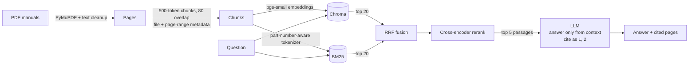

# 🔧 Maintenance Manuals Assistant: RAG over Technical Documents

A chat assistant for maintenance engineers. Ask a question in plain English, such as *"How often should transformer oil be sampled?"*, and get an answer drawn **only** from a library of equipment manuals and safety standards, with the **file and page** it came from. When the manuals don't cover a question, it says **"Not found in the documents."** instead of guessing.

Built from scratch with hybrid retrieval (dense vectors + BM25), cross-encoder reranking, a grounded generation prompt and a measured evaluation on a 50-question test set.

---

## Results

Retrieval evaluation on 42 answerable questions across 19 manuals (2,591 pages). A hit means the gold *file and page* was among the retrieved passages.

| Setup | Hit@5 | Hit@1 | MRR | Latency |
|---|---|---|---|---|
| Vector only (bge-small) | 73.8% | 54.8% | 0.627 | 0.13 s |
| BM25 only | 92.9% | **73.8%** | 0.817 | 0.02 s |
| Hybrid (RRF fusion) | 90.5% | 64.3% | 0.734 | 0.04 s |
| **Hybrid + cross-encoder reranker** | **97.6%** | 69.0% | **0.823** | 0.25 s |

**Findings**
- **The reranker is the biggest win.** It lifts Hit@5 from 90.5% to 97.6%: the right page is found for 41 of 42 questions.
- **Dense vectors alone miss exact identifiers.** In a controlled test, vector search failed to retrieve the part number `6205-2RS`, while BM25 and hybrid search found it. This is why the pipeline combines vector search with keyword search.
- **Plain RRF fusion slightly trails BM25 here.** The weaker vector ranker pulls noise into the fused list, and the reranker then recovers it.
- **Caveat:** the questions were drafted from the source passages, so they share wording with them, which favours lexical search. Rephrased, user-style questions would be a harder and fairer test (see *Next steps*).

Answer **faithfulness** (RAGAS) and **abstention accuracy** on unanswerable questions are computed by `eval/run_eval.py --generate`. In qualitative tests, the local 3B model sometimes over-reached on loosely related context, while the 120B model stayed grounded or abstained. That gap is what the faithfulness metric is designed to expose.

---

## How it works



1. **Ingest** (`src/ingest.py`). PyMuPDF extracts text page by page. Hard line breaks from narrow PDF columns are joined back into paragraphs, while bullets and numbered steps stay separate. A token-based splitter makes ~500-token chunks with 80 tokens of overlap. Each chunk records its **page range**, so a chunk crossing a page break cites `pp. 12–13`.
2. **Index** (`src/index.py`). Chunks are embedded with `BAAI/bge-small-en-v1.5` and stored in Chroma (cosine similarity). A JSONL copy feeds BM25.
3. **Retrieve** (`src/retrieve.py`). Vector search and BM25 each return their top 20 passages. The BM25 tokenizer keeps specs such as `6205-2RS` or `M8x1.25` as single tokens. The two lists are fused with **Reciprocal Rank Fusion**, which avoids tuning weights across incompatible score scales, then reordered by the `ms-marco-MiniLM-L-6-v2` cross-encoder.
4. **Generate** (`src/generate.py`). The prompt only allows facts stated in the numbered passages, requires a `[n]` citation for every claim, and forbids inferring answers from loosely related text. When the answer isn't there, the model must reply exactly *"Not found in the documents."*
5. **Interface** (`app.py`). A Streamlit chat app with citation badges, source cards (document, page, relevance and highlighted terms), optional PDF page previews, a model/retrieval switcher and a live LLM status indicator.

## Evaluation

- **Question set** (`eval/qa_pairs.jsonl`): 50 questions. 42 are answerable, each with a reference answer, gold file, gold page(s) and a verbatim evidence quote; 8 ask about equipment that isn't in the corpus, to test abstention.
- **Drafting** (`eval/draft_questions.py`): an LLM proposes a question from a fact-dense passage, and the gold page is then pinned by locating the evidence quote in the PDF. Every pair is meant to be checked by a person (`"reviewed": true`) before results are reported.
- **Metrics** (`eval/run_eval.py`):
  - retrieval: Hit@5, Hit@1, MRR and latency per setup
  - answers: **RAGAS faithfulness**, scored by a 120B judge model
  - **abstention accuracy** on unanswerable questions, plus **false abstentions** on answerable ones

```bash
python -m eval.run_eval                                         # retrieval metrics, all 4 setups
python -m eval.run_eval --generate --setups hybrid hybrid+rerank  # + answers, abstention, faithfulness
```

## Tech stack

Python · PyMuPDF · LangChain (text splitting, LLM clients) · sentence-transformers · ChromaDB · rank-bm25 · RAGAS · Streamlit · Ollama (local Llama 3.2 3B) / Groq (`gpt-oss-120b`)

## Getting started

```bash
git clone https://github.com/sarthak-bendre/rag-docs-assistant.git
cd rag-docs-assistant
python -m venv .venv
.venv\Scripts\activate                     # macOS/Linux: source .venv/bin/activate
pip install torch --index-url https://download.pytorch.org/whl/cu124   # GPU build (omit for CPU)
pip install -r requirements.txt
copy .env.example .env                     # macOS/Linux: cp; then set GROQ_API_KEY if using Groq

python scripts/download_manuals.py         # fetch the 20 public-domain manuals
python -m src.index                        # chunk, embed and index
streamlit run app.py                       # or double-click start.bat on Windows
```

**LLM options** (set in `.env` or switch in the app's sidebar):
- **Ollama, local and free:** install from [ollama.com](https://ollama.com), then run `ollama pull llama3.2:3b`.
- **Groq, free API tier:** get a key at [console.groq.com](https://console.groq.com), then set `LLM_PROVIDER=groq` and `LLM_MODEL=openai/gpt-oss-120b`.

## Data

The corpus is 20 U.S. government publications, all public domain, chosen for dense numeric specs (limits, intervals, clearances, torques):

| Source | Documents |
|---|---|
| U.S. Dept. of Energy | Sourcebooks for pumping, motors and drives, fans, steam and compressed air; premium-efficiency motor guide; FEMP O&M Best Practices |
| U.S. Army (TM 5-series) | Mechanical and electrical equipment maintenance, system design, transformer maintenance, UPS, electrical commissioning, reliability/availability, cathodic protection |
| NASA | Reliability-Centered Maintenance Guide |
| OSHA | Lockout/tagout, machine safeguarding, electrical hazards, hand and power tools, PPE |

The PDFs are not committed. `scripts/download_manuals.py` fetches them from the URLs in `data/manuals.tsv`.

## Project structure

```
├── app.py                    # Streamlit chat interface
├── start.bat                 # one-click launcher (starts Ollama if needed)
├── src/
│   ├── config.py             # settings from .env
│   ├── ingest.py             # PDF -> clean text -> chunks with page ranges
│   ├── index.py              # embeddings -> Chroma, chunk store for BM25
│   ├── retrieve.py           # vector, BM25, RRF fusion, cross-encoder rerank
│   ├── generate.py           # grounded prompt with citations / "not found"
│   └── llm.py                # Ollama / Groq client factory
├── eval/
│   ├── qa_pairs.jsonl        # 50-question evaluation set
│   ├── run_eval.py           # hit rate, MRR, RAGAS faithfulness, abstention
│   ├── draft_questions.py    # LLM-assisted drafting with page pinning
│   └── browse_chunks.py      # search chunks while writing questions
├── scripts/download_manuals.py
└── data/manuals.tsv          # corpus source URLs
```

## Engineering notes

- **Page-accurate citations.** LangChain's `add_start_index` measures its search offset in tokens but applies it to characters. On repetitive text such as headers and footers, that maps chunks to the wrong pages. Chunk offsets are therefore computed with a strictly forward search.
- **Built for a 6 GB GPU and 16 GB of RAM.** Query-time models run on the CPU so the GPU stays free for the LLM. Ollama runs with an 8K context, which fits 10 passages. Math-library threads are capped to reduce reserved memory.
- **Dependency pin.** RAGAS 0.4 imports modules that LangChain 1.x removed, so the LangChain packages are pinned to 0.3.x.

## Next steps

- Rephrase evaluation questions in users' own words to reduce lexical bias, and add multi-hop questions.
- Run a longer-context embedder (bge-small truncates at 512 word-pieces) and compare chunk sizes.
- Add table-aware extraction for spec tables, and OCR for scanned manuals.
